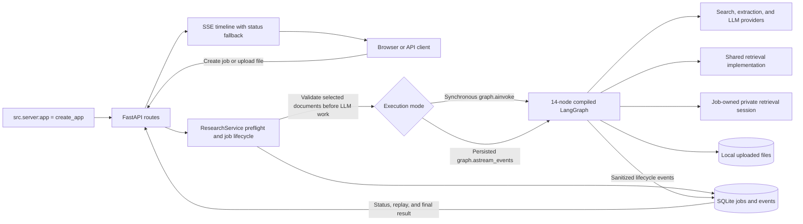
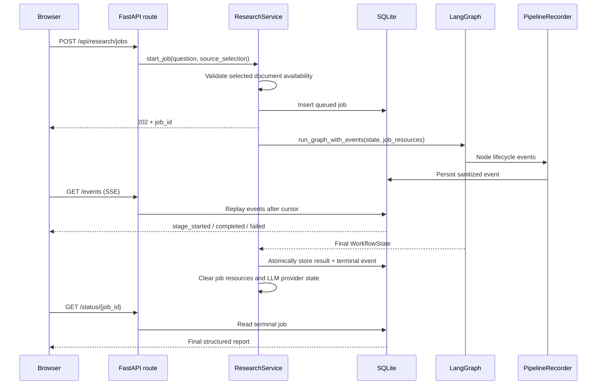
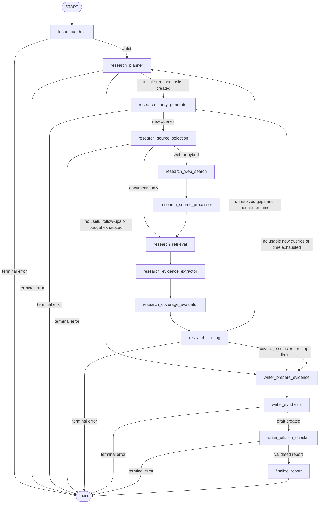
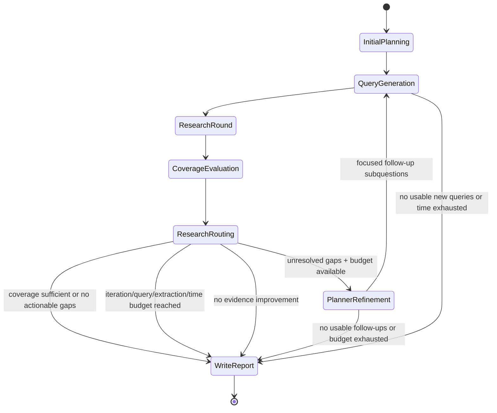
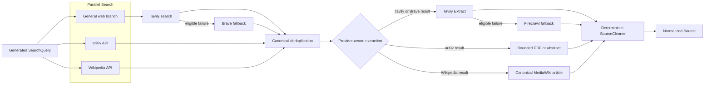
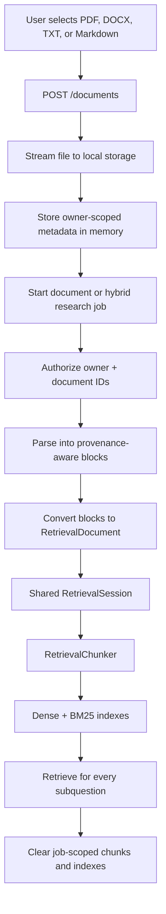
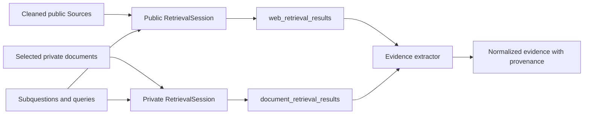
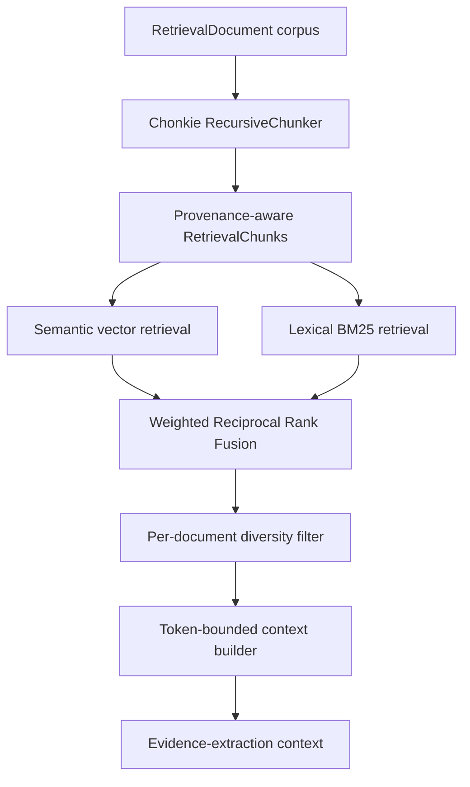
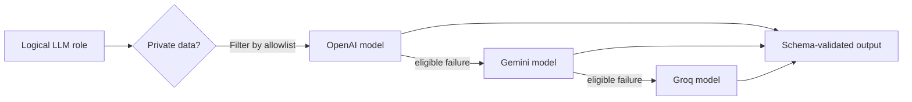
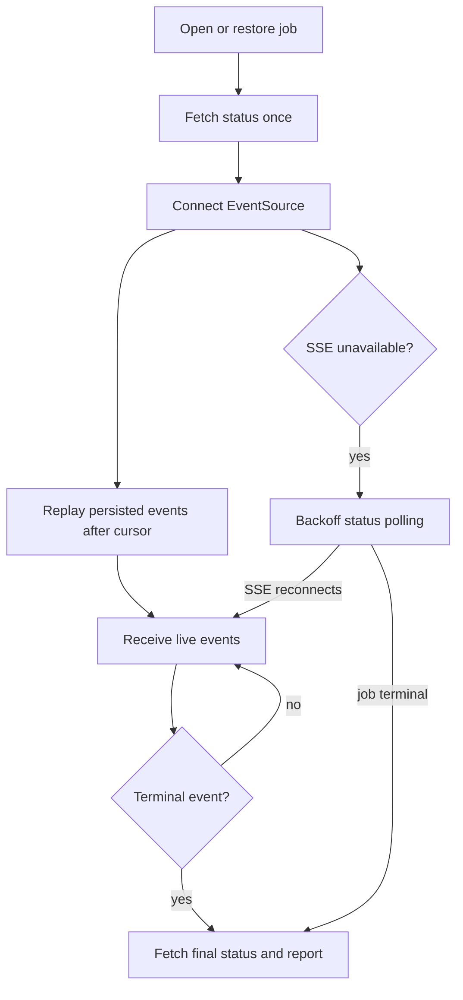

# Deep Research Agent

**Deep Research Agent** is an evidence-grounded research application that turns a question into a structured, source-backed report. It plans the investigation, searches public sources and private documents, retrieves only the most relevant passages, evaluates evidence coverage, performs bounded follow-up research, and verifies citations before rendering the final report.

The project addresses a common failure mode in research assistants: sending large amounts of unfiltered content directly to an LLM and trusting a single response. This application separates discovery, extraction, retrieval, evidence validation, coverage analysis, writing, and citation checking into explicit stages that can be inspected, tested, retried, and observed in real time.

> **Project status:** Web, document, and hybrid research flows are implemented. Public-source search, provider fallbacks, shared hybrid retrieval, SQLite-backed jobs, replayable Server-Sent Events (SSE), and the browser UI have offline test coverage. Authentication, durable distributed execution, restart recovery, and production hardening are not yet implemented.

## Table of Contents

- [Problem and Approach](#problem-and-approach)
- [Key Features](#key-features)
- [Tech Stack](#tech-stack)
- [Architecture](#architecture)
- [Research Pipeline](#research-pipeline)
- [Public-Source Pipeline](#public-source-pipeline)
- [Private-Document Pipeline](#private-document-pipeline)
- [Retrieval Pipeline](#retrieval-pipeline)
- [Evidence, Coverage, and Writing](#evidence-coverage-and-writing)
- [LLM and Provider Fallbacks](#llm-and-provider-fallbacks)
- [Jobs, Events, and UI Updates](#jobs-events-and-ui-updates)
- [State and Resource Lifetimes](#state-and-resource-lifetimes)
- [Getting Started](#getting-started)
- [Usage and API Examples](#usage-and-api-examples)
- [Configuration](#configuration)
- [Project Structure](#project-structure)
- [Testing](#testing)
- [Current Limitations](#current-limitations)
- [Contributing](#contributing)
- [License](#license)

## Problem and Approach

| Research problem | How the project addresses it |
|---|---|
| A broad question is difficult to answer in one prompt. | The planner converts the question into bounded subquestions and objectives. |
| Search results contain duplicates, snippets, boilerplate, and irrelevant text. | Provider adapters normalize results, canonical identifiers merge duplicates, deterministic cleaning removes noise, and retrieval selects relevant passages. |
| One provider can be unavailable or rate-limited. | Search, extraction, and LLM calls use ordered fallbacks with bounded retries and circuit breakers. |
| Public and private sources require different handling. | Web content and private documents use separate retrieval sessions while sharing one chunker and one hybrid-ranking implementation. |
| An LLM may stop too early or repeat broad searches. | A coverage evaluator identifies specific gaps, a deterministic router checks budgets, and the planner creates focused follow-up subquestions before new queries are generated. |
| Generated claims may not be supported by cited evidence. | The writer can reference only accepted evidence, and the citation checker removes unsupported findings before final rendering. |
| Long-running work is hard to understand from a request spinner. | Persisted stage events drive a live, replayable SSE timeline in the UI. |

## Key Features

- **Multi-stage LangGraph workflow:** Explicit nodes handle input validation, planning, query generation, source selection, retrieval, evidence relevance scoring, coverage evaluation, writing, citation checking, and rendering.
- **Three research modes:** Run web-only, document-only, or hybrid research from the same API and UI.
- **Parallel public search:** Search the general web, arXiv, and Wikipedia concurrently for every generated query.
- **Canonical deduplication:** Merge equivalent pages, papers, and articles using canonical IDs, URLs, arXiv IDs, DOIs, and Wikipedia page IDs.
- **Search fallback:** Retry Tavily and fall back to Brave when the configured Brave credentials are available.
- **Extraction fallback:** Use provider-native arXiv and Wikipedia extractors; retry Tavily extraction and fall back to Firecrawl for general webpages when configured.
- **Deterministic source cleaning:** Normalize Unicode, whitespace, HTML, duplicated lines, PDF hyphenation, and content length without spending an LLM call.
- **Shared retrieval pipeline:** Chonkie creates structure-aware chunks, a dense in-memory index and BM25 search the same corpus, and weighted Reciprocal Rank Fusion combines their rankings.
- **Bounded LLM context:** Enforce token limits and per-document diversity before sending retrieved text to the evidence extractor.
- **Private-document provenance:** Preserve document, filename, page, section, character-offset, and chunk metadata through retrieval, evidence, and final citations.
- **Evidence coverage loop:** Judge whether the core request has enough evidence for a grounded report. Return to the planner for material gaps while budgets permit; disclose minor gaps without requiring perfect coverage. Evidence remains linked to the original objectives across rounds.
- **Citation-safe reporting:** Validate evidence references deterministically, perform semantic support checks, remove unsupported findings, and render Markdown from the validated report.
- **Ordered LLM fallback:** Configure OpenAI, Gemini, and Groq independently for each logical role, with private-data provider allowlisting.
- **Persistent job history:** Store asynchronous job status, final results, errors, and ordered progress events in SQLite.
- **SSE-first UI:** Stream replayable progress events, recover the latest job after refresh, and use status polling only when SSE is unavailable.
- **Structured observability:** Emit JSON logs with job, session, node, iteration, provider, role, status, and sanitized failure metadata.

## Tech Stack

| Area | Technology |
|---|---|
| Language | Python 3.13+, JavaScript, HTML, CSS |
| API | FastAPI, Uvicorn, Pydantic, pydantic-settings |
| Workflow | LangGraph |
| LLM abstraction | LangChain |
| LLM providers | OpenAI, Google Gemini, Groq |
| Public search | Tavily, Brave Search, arXiv API, MediaWiki API |
| Content extraction | Tavily Extract, Firecrawl, pypdf, MediaWiki extracts |
| Document parsing | pypdf, python-docx, built-in text parsing |
| Chunking | Chonkie RecursiveChunker |
| Semantic retrieval | Hugging Face embeddings, LangChain InMemoryVectorStore |
| Lexical retrieval | BM25 via rank-bm25 |
| Rank fusion | LangChain EnsembleRetriever with weighted Reciprocal Rank Fusion |
| Persistence | SQLite with aiosqlite and WAL mode |
| Live updates | Server-Sent Events |
| Frontend | Framework-free HTML, CSS, and JavaScript |
| Testing | pytest with fake providers and offline dependencies |
| Observability | Structured JSON logging with job, session, node, iteration, role, and provider metadata |

## Architecture

The architecture below reflects the registered graph, state schema, service composition, and runtime resource lifetimes in the current source.

### System Overview



### Composition and Dependency Flow

`src/server.py` is the application composition root. It creates expensive or shared dependencies once and injects them into the graph:

1. Load typed settings.
2. Configure structured logging.
3. Create the composite public search provider.
4. Create the provider-aware source extractor and deterministic cleaner.
5. Create the SQLite job store.
6. Create one shared embedding service and local tokenizer.
7. Create the retrieval-session factory.
8. Create the application-scoped document service.
9. Create the role-based LLM service.
10. Build and compile the LangGraph workflow.
11. Create `ResearchService`, register routes, and mount the frontend.

This keeps provider construction out of graph nodes. Nodes depend on small application-owned interfaces, which makes them easier to test with fakes.

Only the upload-facing `DocumentService` is stored in `app.state`. Retrieval sessions are created per job or per public retrieval round and reach graph nodes through injected dependencies and `RunnableConfig`, not global application state.

### Code Request Flow



## Research Pipeline

### LangGraph Node Interconnection



Hybrid mode follows the public-search branch, but `research_source_selection` also prepares a private-document retrieval session. The retrieval node queries both sessions and preserves their results separately until the evidence boundary.

### Node Responsibilities

| Node | Problem solved | Implementation |
|---|---|---|
| `input_guardrail` | Invalid questions or incomplete source selections should fail before provider calls. | Validates question length, allowed sources, owner identity, and document selection. |
| `research_planner` | Initial planning and unresolved gaps need focused research tasks. | Creates original objectives initially. On retries, uses gaps, previous tasks/queries, and remaining query capacity to create follow-up subquestions linked to unresolved original objectives. |
| `research_query_generator` | Each planned task needs searchable wording. | Translates the planner's active subquestions into only the necessary queries, deduplicates against prior searches, and enforces per-task and total-job query limits. Gap selection belongs to the planner. |
| `research_source_selection` | Source modes need different runtime resources. | Authorizes selected documents and builds one job-scoped document retrieval session. `route_after_source_selection` chooses the public-search or document-only edge. |
| `research_web_search` | One public search source is incomplete and may fail. | Runs current-round queries through the parallel composite provider and retains normalized results and diagnostics. |
| `research_source_processor` | Search results are not evidence-ready documents. | Loads provider-native or webpage content, cleans it, deduplicates it, and creates normalized `Source` objects. |
| `research_retrieval` | Entire sources are too large and noisy for an LLM. | Builds a public retrieval session over all public sources collected in this job, reuses the job-owned private session, searches each active task's queries independently, and merges ranked chunks into separate bounded web/document contexts. |
| `research_evidence_extractor` | Retrieved passages may be irrelevant, while rewriting them can lose useful detail. | Scores each new chunk against its active task, objective, and current queries; retains original passages meeting `MIN_EVIDENCE_RELEVANCE`. Evidence stays linked to the original objective with task, query, iteration, and source provenance. |
| `research_coverage_evaluator` | The system must know when enough evidence exists to write. | Assesses stable original objectives and overall report readiness, validates evidence IDs, and distinguishes material blockers from minor limitations. |
| `research_routing` | An LLM should not control an unbounded loop. | Deterministically checks coverage, iteration count, query usage, extraction attempts, elapsed time, and evidence gain; continues at `research_planner` or stops for writing. |
| `writer_prepare_evidence` | The writer needs a relevant, balanced evidence set. | Ranks evidence by relevance, gives each subquestion an opportunity to contribute, and stores only selected evidence IDs in writer state. |
| `writer_synthesis` | Evidence must become a readable report without inventing claims. | Produces a topic-specific title, cited summary, and detailed findings grouped into free-form sections; records unresolved gaps as limitations. |
| `writer_citation_checker` | Draft citations may be missing or unsupported. | Performs deterministic reference checks and semantic evidence-to-claim validation; unsupported findings are removed. |
| `finalize_report` | Output formatting should not change validated meaning. | Deterministically renders the validated `ResearchReport` into Markdown. |

### Bounded Research Loop

The research loop continues only when coverage contains actionable gaps and all configured budgets still allow another round.

The path is `research_coverage_evaluator` → `research_routing` → `research_planner` → `research_query_generator`. The router records unresolved gaps in `research_control.pending_gaps`. The planner receives those gaps, the original objectives, previous subquestions and associated queries, and available query capacity. Full coverage assessments and accepted evidence remain in state but are excluded from the refinement prompt. The planner returns focused follow-up subquestions rather than replacing the original objectives.

Each follow-up has a `parent_subquestion_id` identifying an unresolved original objective. The application rejects unknown parents and exact repeated task wording. The query generator translates the selected tasks into searches, reserves one query slot per remaining task, and carries unused capacity forward. Semantic repetition is discouraged by prompts; deterministic deduplication checks normalized text.

Query counts depend on the selected tasks and their evidence needs; there is no separate initial or follow-up round quota. For example, five initial tasks can produce ten queries, then six related gaps can be grouped into three follow-up tasks producing six queries. With a total job allowance of 30, that leaves 14 queries available. These are possible counts, not required quotas: the planner and query generator may return fewer tasks or searches when sufficient.



Supported stop reasons include:

- **`coverage_sufficient`:** Evidence supports a grounded answer to the core request at the requested depth; minor limitations may remain.
- **`max_iterations`:** The bounded round limit was reached.
- **`query_budget_exhausted`:** The job used its permitted query count.
- **`extraction_budget_exhausted`:** The job reached its page-processing limit.
- **`time_budget_exhausted`:** Research exceeded its elapsed-time budget.
- **`no_evidence_improvement`:** Additional rounds stopped contributing newly referenced evidence.
- **`no_actionable_gaps`:** Coverage is incomplete, but no useful follow-up gap remains.

## Public-Source Pipeline

### Search, Deduplication, Extraction, and Cleaning



#### Search Behavior

- **Parallel branches:** General web, arXiv, and Wikipedia searches run concurrently under a shared semaphore.
- **Result limits and fairness:** Each branch keeps its own result cap. After canonical merging, shared title/snippet/date ranking orders each provider's bucket, and the buckets are interleaved before the aggregate limit. Raw provider scores do not affect cross-provider ranking or its tie-breaks; missing native scores are not treated as poor relevance. Not every discovered result reaches extraction. Progress records both discovered and retained provider counts.
- **Relevance before diversity:** When text-matching candidates exist, zero-overlap title/snippet candidates wait until after their provider-interleaved matches. They remain fallback candidates, not discarded sources. This is a conservative lexical heuristic, not proof of semantic relevance.
- **Partial success:** A failed branch does not discard useful results from healthy branches. The query fails only when every branch fails.
- **General-search fallback:** Tavily retries first. Brave activates only for failures classified as eligible for fallback and only when `BRAVE_API_KEY` is configured.
- **Canonical merging:** Duplicate identities are detected from canonical IDs, normalized URLs, DOI values, arXiv IDs without version suffixes, Wikipedia page IDs, and Wikipedia titles.
- **Discovery provenance:** When multiple providers discover the same source, the representative result retains all discovery metadata.

#### Extraction Behavior

- **Query/provider-balanced allocation:** Candidate pages rotate across queries and subquestions, reusing the shared provider-interleaving ranker. The starting provider rotates across intents so one provider does not always consume their first extraction opportunities. Shared URLs are extracted once and retain every discovery relationship; round/job extraction caps still apply. Provider diversity is an opportunity to inspect content, not a guarantee that the evidence scorer will accept it.
- **General webpages:** Tavily Extract is primary; Firecrawl is the optional fallback.
- **arXiv:** The native adapter downloads a bounded PDF and reuses the existing PDF parser. If full text is disabled or unusable, it falls back to the abstract. Metadata records PDF versus abstract, fallback reason, total pages, pages processed, pages with text, and page-limit truncation. The citation URL can remain `/abs/` even when extraction used `/pdf/`.
- **Wikipedia:** The native adapter requests canonical plain text, redirects, page ID, and revision metadata from MediaWiki.
- **Circuit breaking:** Repeated eligible failures temporarily open a provider circuit so every URL or query does not repeatedly call an unhealthy service.

#### Deterministic Cleaning

`SourceCleaner` runs after extraction and before retrieval. It:

- normalizes Unicode and line endings;
- removes control characters;
- converts useful HTML structure into readable text;
- drops script, style, navigation, footer, and other boilerplate elements;
- joins PDF-style line-break hyphenation;
- collapses whitespace and duplicate adjacent lines;
- enforces minimum and maximum content lengths; and
- records cleaner version and size metadata for traceability.

The cleaner does not call an LLM.

## Private-Document Pipeline

### Upload and Research-Time Processing



Uploads and indexing are intentionally separate:

1. **Upload time:** The service validates the extension, streams the file to disk, computes a SHA-256 hash, and stores metadata. It does not parse, chunk, embed, or index the file.
2. **Job start:** `research_source_selection` verifies that every selected document belongs to the request owner.
3. **Parsing:** PDF pages, DOCX paragraphs, or text content become normalized blocks with available page and character provenance.
4. **Shared retrieval preparation:** Blocks become `RetrievalDocument` objects and enter the same `RetrievalSession` implementation used for public content, but in a separate job-owned session.
5. **Reuse during the job:** One private-document session serves every subquestion and later coverage iteration.
6. **Cleanup:** Job-scoped chunks and indexes are cleared when the workflow completes, fails, or is cancelled.

The original uploaded file remains on local disk unless the optional deletion call in `DocumentService` is enabled. Document metadata is held by an application-scoped in-memory registry, so it does not survive a server restart.

### Hybrid Source Isolation



Public and private chunks are not inserted into one long-lived shared vector database. Separate sessions reduce accidental cross-job or cross-source leakage, while the evidence extractor provides the single controlled merge point.

## Retrieval Pipeline



### Why Hybrid Retrieval

- **Semantic retrieval** finds conceptually related passages even when wording differs from the query.
- **BM25 retrieval** preserves exact terms, names, identifiers, and domain-specific keywords.
- **Reciprocal Rank Fusion** combines both ranked lists without requiring their raw scores to be comparable.
- **Diversity limits** prevent one long source from occupying the entire context.
- **Token accounting** stops context growth before the evidence LLM call.

`src/retrieval/chunking/retrieval_chunker.py` is the only chunking implementation. Public sources and private documents both pass through it, ensuring consistent chunk boundaries and provenance behavior.

For each active task, `RetrievalSession.retrieve()` searches its queries independently, interleaves the rankings, and removes duplicate chunk IDs before applying the existing context and per-document limits. Each source branch produces one bounded context per task, avoiding an extra evidence-scoring LLM call for every search query.

`RetrievalResult.query_matches` records each intent's hybrid match count and how many matches entered the final bounded context. The same passage may match several queries: per-query counts overlap and do not represent distinct accepted evidence. Progress events expose these counts and generated query text, not raw passages or private file metadata.

Before indexing public chunks, the shared hybrid retriever excludes obvious link menus and bibliography-dominated passages. The filter preserves numbered factual lists, tables, and ordinary in-text citations, and does not filter private-document chunks. It does not rewrite content, change chunk IDs, replace RRF, or guarantee that every remaining match is useful. Follow-up queries search the job's earlier collected public sources too; the bounded public index is rebuilt per round, while accepted evidence is not rescored for the same original objective.

### Data Transformation

```text
SearchResult
    -> Source
    -> RetrievalDocument
    -> RetrievalChunk
    -> RetrievedChunk
    -> RetrievalResult
    -> Evidence
    -> ReportFinding
    -> ResearchReport
```

The pipeline selects and transforms data while retaining identifiers needed to trace a final finding back to its source and chunk. The evidence stage retains selected chunk text unchanged rather than generating compressed claims.

## Evidence, Coverage, and Writing

### Evidence Boundary

`research_evidence_extractor` keeps its existing node name and `EVIDENCE_MODEL` configuration, but now performs relevance scoring rather than text extraction. For each source branch and active task, it supplies new, nonblank retrieved chunks plus the original question, task objective, and current-round queries. The LLM returns only each chunk's exact ID and a 0–1 relevance score; the application builds evidence containing:

- the original chunk text, unchanged;
- the associated subquestion;
- the source and chunk identifiers;
- relevance and provenance metadata; and
- private-document locations when applicable.

`MIN_EVIDENCE_RELEVANCE` controls admission (default `0.60`, inclusive). Scores judge usefulness, not factual certainty or source reliability; relevant contradictions and null results can be useful. Unknown IDs and duplicate judgments are rejected, and missing scores never default to acceptance. Partial responses retain only valid, sufficiently relevant judgments and record a recoverable error plus log diagnostics. Within each response, higher-scored chunks receive remaining evidence capacity first.

Web and document evidence joins one downstream collection. Deduplication uses original objective ID plus chunk ID, preserving equal text from different source chunks. Already accepted chunks are not rescored for that objective, and evidence from earlier rounds remains available. Full retained passages can increase downstream context costs; retrieval and writer limits still apply.

Follow-up evidence uses the original objective's ID in `Evidence.subquestion_id`. Provenance records `research_subquestion_id`, `research_iteration`, and `research_query_ids` for the task that discovered it. These query IDs identify task-level search intent, not an exact per-chunk query match. Coverage and writing therefore retain access to evidence from all rounds.

### Coverage Evaluation

The coverage evaluator checks every original planned subquestion against accumulated evidence and the previous coverage result. Follow-up tasks do not become additional coverage requirements. It can identify:

- supported objectives;
- partially supported objectives;
- missing evidence;
- conflicting evidence; and
- actionable follow-up gaps.

The evaluator judges report readiness rather than requiring every objective to be perfectly covered. One specific, relevant passage can support a subquestion; corroboration is preferred, not a fixed two-source requirement. Evidence strength remains descriptive, and uncertainty or explainable disagreement does not automatically require another round. Explicitly requested topics, comparisons, and time periods must not be dismissed as optional.

When overall status is `insufficient`, `coverage.gaps` identifies material blockers and the evidence needed to resolve them. When status is `sufficient`, the same field preserves remaining minor limitations for the writer. Partial or missing peripheral objectives therefore need not block a useful report. Reference validation still rejects unsupported readiness claims, invented/cross-objective evidence IDs, and missing or duplicate assessments. Normalization no longer manufactures research gaps from every partial status or from contradictory overall output.

The deterministic router—not the LLM—enforces the stop conditions. `sufficient` goes directly to writing even with minor limitations and unused budget. Otherwise, actionable gaps return to the planner while limits permit; absent actionable gaps stop research rather than generating artificial follow-ups. The planner turns material gaps into follow-up subquestions before the query generator creates searches.

### Writer and Citation Pipeline


The writer cannot cite evidence it did not receive. The citation checker verifies that referenced evidence and sources exist, then checks whether the cited evidence actually supports each finding. Findings that fail validation do not reach the final report.

`DraftReport` keeps the report structure flexible without creating topic-specific schemas:

- **Title and executive summary:** A subject-specific title and an answer-first, evidence-cited summary.
- **Thematic findings:** Each finding has a free-form `section`, focused `title`, detailed `content`, and supporting `evidence_ids`. Content can contain paragraphs, lists, or Markdown tables. Sections fit the question rather than a fixed financial, scientific, or technical template.
- **Limitations:** Missing evidence, conflicts, and research constraints are explicit. Comparisons, scenarios, and implications appear only when supported by supplied evidence.

The synthesis node does not silently strip invalid references; the citation checker rejects affected findings. The checker also produces a summary based on surviving findings and converts its evidence citations to the same source numbers used in the body. The final API report preserves `title` and each finding's `section`; the UI and Markdown renderer group related findings under those headings. Markdown rendering generates the research approach and Cited Sources once. Older reports without the new fields use the existing default title and Detailed Analysis section.

## LLM and Provider Fallbacks

### Role-Based LLM Selection

Nodes request logical roles rather than concrete provider SDKs:

- `planner`
- `query_generator`
- `evidence_extractor`
- `coverage_evaluator`
- `writer`
- `citation_checker`

Each role can define its own ordered provider/model chain.

These are structured LLM calls, not autonomous agent executors. The graph contains no ReAct loop, LLM tool-selection loop, nested LangGraph, human interrupt, or checkpoint-backed resume path. Search, extraction, parsing, retrieval, persistence, and rendering are invoked directly by application code.



The service:

- preserves configured provider order;
- filters providers through `LLM_PRIVATE_DATA_PROVIDERS` for document and hybrid jobs;
- retries malformed structured output a bounded number of times;
- fails over on classified availability, authentication, rate-limit, timeout, server, and provider-specific structured-output failures;
- keeps invalid prompts, policy failures, oversized requests, and context-length failures terminal when another provider is unlikely to help;
- remembers the successful provider independently for later calls to the same role in the same job; and
- releases job-specific provider state at job completion.

### Search and Extraction Resilience

| Capability | Primary | Fallback | Activation |
|---|---|---|---|
| General web search | Tavily | Brave | Eligible primary failure and configured Brave key |
| General webpage extraction | Tavily Extract | Firecrawl | Eligible primary failure or unusable extraction and configured Firecrawl key |
| arXiv content | Bounded PDF | arXiv abstract | PDF disabled, unavailable, invalid, oversized, or unparsable |
| Wikipedia content | MediaWiki API | None | Branch remains recoverable when other public branches succeed |
| Structured LLM role | First configured eligible provider | Next configured provider | Classified call failure and private-data policy eligibility |

## Jobs, Events, and UI Updates

### Persistence and Streaming

SQLite stores:

- **`research_jobs`:** IDs, question, allowed sources, lifecycle status, final result, error message, and timestamps.
- **`research_events`:** Ordered, per-job progress events keyed by `(job_id, sequence)`.

The terminal job update and terminal event are committed in one transaction so the UI cannot observe a terminal event without a matching result.

Representative event types:

| Event | Meaning |
|---|---|
| `workflow_started` | Graph execution began. |
| `stage_started` | A named pipeline node started. |
| `stage_completed` | A node completed successfully. |
| `stage_failed` | A node returned or raised a terminal failure. |
| `research_retry` | The router scheduled a follow-up round starting with planner refinement. |
| `research_stopped` | Research ended and writing can begin. |
| `workflow_completed` | A final report was persisted. |
| `workflow_failed` | A terminal error was persisted. |

### SSE-First Browser Behavior



Completed research stages have expandable output details:

- **Research planning:** Current subquestions, objectives, and the original question behind each follow-up task. Initial planning appears inside research round one, just like follow-up planning.
- **Generate search queries:** Current-round queries and their purposes, grouped under the associated subquestion.
- **Search public sources:** Discovered Tavily/Brave, arXiv, and Wikipedia result counts before aggregate selection, alongside retained totals after filtering, partial failures, and fallback activation. Zero-result enabled branches remain visible. Counts are returned matches, not the provider's total estimated hits or globally unique sources.
- **Extract public source content:** New usable pages per discovery provider and in total, extraction attempts, reused pages, and budget-deferred candidates. Reused pages are available for retrieval but are not counted as newly extracted pages.
- **Find relevant passages:** Separate public and private rows show per-subquestion context sizes and each query's retrieved/selected passage counts. Both rows describe the same graph retrieval node. With no documents attached, the private row is greyed out and marked skipped; document-only research omits the public stages.
- **Score evidence relevance:** Passages scored, kept, filtered below the configured threshold, or skipped because of evidence capacity. Missing/invalid judgments and scoring failures are separate diagnostics; below-threshold does not mean factually incorrect. Previously accepted passages are not rescored.
- **Evaluate coverage:** Supported, partial, missing, and conflicting objective counts, with each objective's explanation, evidence strength, supporting-passage count, and remaining gaps. Sufficient coverage labels remaining gaps as report limitations.

Details are scoped to their research round and replay with persisted events after refresh. User-expanded panels remain open during live updates. Writer stages retain their existing progress-only view. Older events without richer payloads still render their available counts. To bound event size, lists display at most 100 items and text fields at most 1,000 characters; the UI marks list truncation and shortened text uses an ellipsis. Totals include all items.

The timeline identifies the current job, and search details explicitly identify their job/round and executed-query count when recorded. Counts are per round, not cumulative job totals. The `web_search_completed` application log uses matching discovered/retained summary fields under the same job and iteration, so compare matching scopes rather than another job's individual provider prints.

Report bodies use locally bundled Marked and DOMPurify for sanitized GitHub-flavored Markdown, including tables, lists, emphasis, links, and code. Table columns preserve alignment and scroll horizontally when needed. Images, scripts, embeds, event handlers, and unsafe links are excluded. Headings retain the safe inline formatter. The generated-Markdown disclosure remains a literal, copyable source view; no CDN is needed.

Scoring details group passage decisions by research task and show matched queries, scores, the threshold, and computed acceptance/rejection reasons. Public previews are limited to 800 characters; scoring still uses the complete retrieved passage. At most 100 audit rows enter each event, with truncation indicated. Private passage contents, chunk identifiers, filenames, paths, and owner IDs are redacted; only their scores/decisions remain visible. A source funnel shows collected → retrieved → accepted → supplied to writer → cited counts. The final list is labeled **Cited sources**, not all downloaded sources.

Event payloads explicitly allowlist generated summaries, counters, and bounded public scoring previews, not full prompts, source bodies, provider responses, or reports. Generated questions, queries, and coverage explanations can still contain research-sensitive information. Job-viewing routes are currently unauthenticated, so treat a job link and its stored events as sensitive, just like the final report. Authentication remains required before production use with private research.

## State and Resource Lifetimes

Understanding resource scope is important because the project intentionally avoids one global mixed-source vector database.

| Scope | Resources | Lifetime |
|---|---|---|
| Application process | Settings, provider clients, embedding service, tokenizer, retrieval factory, document service, in-memory document registry | Server process |
| Research job | LangGraph state, private-document retrieval session, LLM provider preference/failure state | One job |
| Public retrieval invocation | Job-collected public chunks, dense index, BM25 index, current-task retrieval contexts | Rebuilt for one retrieval-node invocation; the current explicit `clear()` call is disabled |
| Persistent local storage | SQLite jobs/events, uploaded source files | Until manually removed |
| Browser | Temporary owner ID and last job ID | Browser local storage |

### Workflow State Ownership

| State section | Owns |
|---|---|
| Root | Job/session IDs, question, owner ID, selected source mode, selected document IDs, structured errors |
| `research` | Original `subquestions`, current `active_subquestions`, `planning_history`, queries, search results, normalized sources, separate web/document retrieval results, accumulated evidence, current-round `search_stats`, `extraction_stats`, `evidence_stats`, private-safe `evidence_audit`, cumulative `retrieved_source_ids`, coverage, iteration count, stop reason |
| `research_control` | Budgets, usage, pending gaps, routing decision, and round history |
| `writer` | Selected evidence IDs, source-lineage counters (`source_stats`), draft report, citation result, and final report |

Non-serializable retrieval indexes stay in `ResearchJobResources`, outside graph state.

`WorkflowState` is a `TypedDict` without `Annotated` reducers. A returned top-level key replaces that key; nodes preserve nested `research` and `writer` fields with explicit dictionary spreads, append or deduplicate lists themselves, and update `ResearchControlState` through Pydantic `model_copy()`. The private retrieval session and per-job LLM provider health remain runtime resources rather than serializable graph state.

Initial planning populates all three planning lists. Later planner calls preserve `subquestions`, replace `active_subquestions`, and append new tasks to `planning_history`. Queries reference active task IDs; accepted evidence is mapped back to original objective IDs.

## Getting Started

### Prerequisites

- **Python:** 3.13 or newer, matching `pyproject.toml`.
- **Package tooling:** `pip` and `venv`.
- **Tavily:** A Tavily API key is currently required by application settings for general search and extraction.
- **LLM access:** At least one supported provider key and model ID: OpenAI, Google Gemini, or Groq.
- **Network access:** Required for public research and the first download of the local embedding model and tokenizer.

Brave and Firecrawl credentials are optional. arXiv and Wikipedia use public APIs and do not require API keys.

### Installation

Clone the repository and create a virtual environment:

```bash
git clone https://github.com/Ishwaridutt/deep-research-agent.git
cd deep-research-agent
python3.13 -m venv .venv
source .venv/bin/activate
python -m pip install --upgrade pip
python -m pip install -r requirements.txt
```

On Windows PowerShell, activate the environment with:

```powershell
.venv\Scripts\Activate.ps1
```

### Environment Configuration

Copy the provided template:

```bash
cp .env.example .env
```

Configure at least Tavily and one LLM provider. This single-provider example uses Groq:

```dotenv
TAVILY_API_KEY=replace-with-your-tavily-key
GROQ_API_KEY=replace-with-your-groq-key

LLM_PROVIDER=groq
LLM_PROVIDER_ORDER=groq
LLM_PRIVATE_DATA_PROVIDERS=groq

PLANNER_MODEL=groq:replace-with-supported-model-id
QUERY_GENERATOR_MODEL=groq:replace-with-supported-model-id
EVIDENCE_MODEL=groq:replace-with-supported-model-id
COVERAGE_MODEL=groq:replace-with-supported-model-id
WRITER_MODEL=groq:replace-with-supported-model-id
CITATION_MODEL=groq:replace-with-supported-model-id

LANGSMITH_TRACING=false
```

To enable the full LLM fallback chain, configure all provider keys and give each role a comma-separated chain:

```dotenv
OPENAI_API_KEY=replace-with-your-openai-key
GOOGLE_API_KEY=replace-with-your-google-key
GROQ_API_KEY=replace-with-your-groq-key

LLM_PROVIDER_ORDER=openai,google_genai,groq
LLM_PRIVATE_DATA_PROVIDERS=openai,google_genai,groq

PLANNER_MODEL=openai:OPENAI_MODEL_ID,google_genai:GEMINI_MODEL_ID,groq:GROQ_MODEL_ID
```

Apply the same chain format to the other five role settings. Never commit `.env` or real credentials.

### Running Locally

```bash
source .venv/bin/activate
python -m uvicorn src.server:app --reload
```

Open:

- **Application:** http://127.0.0.1:8000/
- **API documentation:** http://127.0.0.1:8000/docs
- **Health check:** http://127.0.0.1:8000/health

Use one Uvicorn worker. Background tasks, document metadata, and job-owned resources are currently process-local and are not coordinated across workers.

## Usage and API Examples

### Browser Workflow

1. Enter a research question.
2. Select **Web**, **Documents**, or **Hybrid**.
3. For document or hybrid research, choose one or more `.pdf`, `.docx`, `.txt`, or `.md` files, or select existing uploads from the current process.
4. Select **Start research**. Pending files upload automatically before the research job starts.
5. Follow the live pipeline, provider progress, coverage rounds, and final report.

### API Endpoints

| Method | Endpoint | Purpose |
|---|---|---|
| `GET` | `/` | Serve the browser workspace. |
| `GET` | `/health` | Return application health. |
| `POST` | `/documents` | Upload one owner-scoped private document. |
| `GET` | `/documents` | List documents for an owner. |
| `POST` | `/api/research` | Run a synchronous research workflow. |
| `POST` | `/api/research/jobs` | Queue an asynchronous persisted job. |
| `GET` | `/api/research/jobs/status/{job_id}` | Read lifecycle state and terminal result. |
| `GET` | `/api/research/jobs/{job_id}/events` | Replay and stream SSE events. |

### Start a Web Research Job

```bash
curl -X POST http://127.0.0.1:8000/api/research/jobs \
  -H 'Content-Type: application/json' \
  -d '{
    "question": "How are agentic AI systems changing software engineering?",
    "source_selection": {
      "mode": "web",
      "document_ids": []
    }
  }'
```

Example response:

```json
{
  "job_id": "JOB-example",
  "research_session_id": "RS-example",
  "status": "queued"
}
```

### Upload and Use a Private Document

Use the same owner ID for upload, listing, and research:

```bash
OWNER_ID="local-example-owner"

curl -X POST http://127.0.0.1:8000/documents \
  -H "X-Owner-Id: ${OWNER_ID}" \
  -F "file=@./example.pdf"
```

Copy the returned `document_id`, then create a hybrid job:

```bash
DOCUMENT_ID="returned-document-id"

curl -X POST http://127.0.0.1:8000/api/research/jobs \
  -H 'Content-Type: application/json' \
  -H "X-Owner-Id: ${OWNER_ID}" \
  -d "{
    \"question\": \"Compare this document with current public research.\",
    \"source_selection\": {
      \"mode\": \"hybrid\",
      \"document_ids\": [\"${DOCUMENT_ID}\"]
    }
  }"
```

Use `"mode": "documents"` for private-document-only research.

### Check Job Status

```bash
curl http://127.0.0.1:8000/api/research/jobs/status/JOB-example
```

Status is one of `queued`, `running`, `completed`, or `failed`. A terminal response includes the structured execution result and either the validated report or structured errors.

### Stream Pipeline Events

```bash
curl -N http://127.0.0.1:8000/api/research/jobs/JOB-example/events
```

Replay only events after sequence 20:

```bash
curl -N 'http://127.0.0.1:8000/api/research/jobs/JOB-example/events?after=20'
```

The endpoint also honors the `Last-Event-ID` header used by browser `EventSource` reconnections.

### Run Synchronously

```bash
curl -X POST http://127.0.0.1:8000/api/research \
  -H 'Content-Type: application/json' \
  -d '{
    "question": "What are the major approaches to evaluating AI agents?",
    "source_selection": {"mode": "web", "document_ids": []}
  }'
```

The connection remains open until the workflow completes. Prefer the job API for the interactive UI and long-running research.

## Configuration

Use `.env.example` as the complete configuration reference.

### LLM Settings

| Variable | Purpose |
|---|---|
| `OPENAI_API_KEY`, `GOOGLE_API_KEY`, `GROQ_API_KEY` | Provider credentials. |
| `LLM_PROVIDER` | Default provider for unqualified model names. |
| `LLM_PROVIDER_ORDER` | Global provider preference order. |
| `LLM_PRIVATE_DATA_PROVIDERS` | Providers allowed to receive private-document content. |
| `*_MODEL` | Provider-qualified model chain for each logical role. |
| `LLM_TIMEOUT_SECONDS` | Per-provider timeout. |
| `LLM_MAX_RETRIES` | Provider SDK retry count. |
| `LLM_STRUCTURED_OUTPUT_METHOD` | LangChain structured-output method. |
| `LLM_STRUCTURED_OUTPUT_ATTEMPTS` | Bounded parsing/schema attempts. |

### Search and Extraction Settings

| Variable | Purpose |
|---|---|
| `TAVILY_API_KEY` | Required general search and extraction credential. |
| `BRAVE_API_KEY` | Optional general-search fallback credential. |
| `FIRECRAWL_API_KEY` | Optional webpage-extraction fallback credential. |
| `ARXIV_ENABLED`, `WIKIPEDIA_ENABLED` | Enable native public search branches. |
| `ARXIV_FULL_TEXT_ENABLED` | Attempt bounded arXiv PDF extraction before abstract fallback. |
| `SEARCH_MAX_CONCURRENCY` | Maximum concurrent provider branches. |
| `*_RESULTS_PER_QUERY` | Per-provider result caps. |
| `PROVIDER_MAX_RETRIES` | Application-level provider retries. |
| `PROVIDER_CIRCUIT_*` | Circuit-breaker threshold and recovery window. |

### Retrieval Settings

All retrieval variables use the `RETRIEVAL_` prefix.

| Variable | Default | Purpose |
|---|---:|---|
| `RETRIEVAL_EMBEDDING_MODEL` | `BAAI/bge-small-en-v1.5` | Local semantic embedding model. |
| `RETRIEVAL_EMBEDDING_DEVICE` | `cpu` | Embedding execution device. |
| `RETRIEVAL_CHUNK_SIZE` | `400` | Chonkie chunk size. |
| `RETRIEVAL_CANDIDATE_K` | `20` | Candidates requested from each retrieval path. |
| `RETRIEVAL_TOP_K` | `8` | Fused passages considered for context. |
| `RETRIEVAL_SEMANTIC_WEIGHT` | `0.5` | Dense-ranking contribution. |
| `RETRIEVAL_LEXICAL_WEIGHT` | `0.5` | BM25-ranking contribution. |
| `RETRIEVAL_RRF_C` | `60` | Reciprocal Rank Fusion constant. |
| `RETRIEVAL_MAX_CONTEXT_TOKENS` | `3000` | Maximum selected retrieval context. |
| `RETRIEVAL_MAX_CHUNKS_PER_DOCUMENT` | `3` | Per-document diversity cap. |

### Research and Document Limits

| Variable | Purpose |
|---|---|
| `MAX_SUBQUESTIONS` | Maximum original objectives or follow-up tasks produced by a planner call, subject to remaining query capacity. Default: 5. |
| `MAX_QUERIES_PER_SUBQUESTION` | Maximum queries per active task; the model may generate fewer when sufficient. Default: 3. |
| `MAX_TOTAL_QUERIES_PER_JOB` | Job-wide query budget. |
| `MAX_EXTRACTED_PAGES_PER_ROUND` | Extraction attempts per round, default 30; the existing job-wide limit remains 60. Reused sources do not consume new extraction attempts. |
| `MAX_SOURCE_DOWNLOAD_BYTES` | Bounded source/PDF download size. |
| `MIN_SOURCE_CONTENT_CHARS`, `MAX_SOURCE_CONTENT_CHARS` | Cleaner acceptance limits. |
| `MIN_EVIDENCE_RELEVANCE` | Minimum accepted evidence relevance. |
| `MAX_EVIDENCE_ITEMS` | Maximum accumulated evidence. |
| `MAX_ITERATIONS` | Maximum research rounds. |
| `MAX_WRITER_EVIDENCE_ITEMS`, `MAX_WRITER_EVIDENCE_CHARS` | Writer context bounds. |
| `DOCUMENT_MAX_TOTAL_SIZE_BYTES` | Per-owner upload quota in the in-memory registry. |
| `DOCUMENT_UPLOAD_DIRECTORY` | Local uploaded-file directory. |

## Project Structure

```text
.
├── src/
│   ├── agents/
│   │   ├── research/                 # Planning, search, retrieval, evidence, coverage nodes
│   │   └── writer/                   # Evidence selection, synthesis, citation checking
│   ├── config/
│   │   ├── settings.py               # Typed environment configuration
│   │   └── logging.py                # Structured JSON logging
│   ├── documents/
│   │   ├── document_parser.py        # PDF, DOCX, text, and Markdown parsing
│   │   ├── document_registry.py      # Process-local owner-scoped metadata
│   │   └── local_document_file_store.py
│   ├── graph/
│   │   ├── graph_builder.py          # LangGraph nodes and edges
│   │   ├── graph_routing.py          # Deterministic conditional routing
│   │   └── graph_state.py            # Workflow state ownership
│   ├── guardrails/                   # Input and URL validation
│   ├── llm/
│   │   ├── factory.py                # Provider/model-chain construction
│   │   ├── roles.py                  # Logical LLM responsibilities
│   │   └── service.py                # Structured output, policy, and fallback
│   ├── models/                       # Pydantic domain and API contracts
│   ├── persistence/
│   │   └── research_job_store.py     # SQLite jobs and ordered events
│   ├── prompts/                      # Role-specific prompt builders
│   ├── rendering/                    # Deterministic report rendering
│   ├── retrieval/
│   │   ├── chunking/                 # Single shared RetrievalChunker
│   │   ├── context/                  # Token-bounded context selection
│   │   ├── embeddings/               # Shared embedding service
│   │   └── retrievers/               # BM25, dense retrieval, and RRF
│   ├── routes/                       # Research, document, health, and UI routes
│   ├── services/
│   │   ├── document_service.py       # Upload and research-time document adaptation
│   │   ├── research_service.py       # Job lifecycle and graph execution
│   │   └── research_pipeline_stream_service.py
│   ├── static/                       # Browser workspace
│   ├── tests/                        # Offline focused and integration-style tests
│   ├── tools/
│   │   ├── cleaning/                 # Deterministic SourceCleaner
│   │   ├── extraction/               # Native, web, and fallback extractors
│   │   └── search/                   # Parallel search and provider adapters
│   └── server.py                     # FastAPI composition root
├── docs/                             # Architecture, phase plans, and implementation handoffs
├── data/                             # Runtime SQLite database
├── uploaded/                         # Runtime private uploads; gitignored
├── .env.example                      # Safe configuration template
├── requirements.txt
├── pyproject.toml
└── readme.md
```

### Important Entry Points

| File | Start here when changing |
|---|---|
| `src/server.py` | Application wiring, resource creation, startup, and shutdown |
| `src/graph/graph_builder.py` | Node order or conditional graph edges |
| `src/graph/graph_routing.py` | Research-loop and terminal routing rules |
| `src/graph/graph_state.py` | Data shared between nodes |
| `src/services/research_service.py` | Synchronous/asynchronous job execution |
| `src/services/research_pipeline_stream_service.py` | SSE lifecycle event capture and sanitization |
| `src/retrieval/retrieval_session.py` | Shared indexing and retrieval boundary |
| `src/tools/search/factory.py` | Search-provider composition |
| `src/tools/extraction/factory.py` | Extraction-provider composition |
| `src/static/js/app.js` | UI submissions, SSE connection, recovery, and rendering |

## Testing

Tests must not call real LLM, search, extraction, or embedding providers. The suite uses fake dependencies and disables dotenv loading:

```bash
PYTHON_DOTENV_DISABLED=1 .venv/bin/python -m pytest -q src/tests
```

Additional checks:

```bash
PYTHON_DOTENV_DISABLED=1 .venv/bin/python -m compileall -q src
node --check src/static/js/app.js
git diff --check
```

Focused examples:

```bash
PYTHON_DOTENV_DISABLED=1 .venv/bin/python -m pytest -q src/tests/test_retrieval_pipeline.py
PYTHON_DOTENV_DISABLED=1 .venv/bin/python -m pytest -q src/tests/test_parallel_search.py
PYTHON_DOTENV_DISABLED=1 .venv/bin/python -m pytest -q src/tests/test_provider_fallbacks.py
PYTHON_DOTENV_DISABLED=1 .venv/bin/python -m pytest -q src/tests/test_llm_fallback.py
PYTHON_DOTENV_DISABLED=1 .venv/bin/python -m pytest -q src/tests/test_hybrid_evidence_flow.py
```

The suite changes with the implementation; run the command above for the current result instead of relying on a fixed test count.

## Current Limitations

- **Temporary owner identity:** `X-Owner-Id` is not authentication. Do not expose private-document routes publicly without real identity and authorization.
- **Process-local document metadata:** Uploaded files remain on disk, but the in-memory document registry is lost on restart. Previously uploaded files cannot be selected again without rebuilding metadata.
- **No workflow checkpoint resume:** SQLite preserves jobs and events, not LangGraph execution checkpoints. Queued or running jobs are marked failed after a restart.
- **Single-process execution:** Background tasks, admission control, and runtime resources are not coordinated across Uvicorn workers or machines.
- **In-memory retrieval indexes:** Dense and BM25 indexes are not persisted. The private session is cleared on terminal job paths; explicit public-session cleanup is currently disabled in `research_retrieval_node` and should be restored before production hardening.
- **Writer budget enforcement:** Evidence selection stops after observed item or character totals reach their limits, but `_evidence_fits_budget()` currently returns `True`, so the item that crosses the remaining character budget can still be accepted.
- **No durable task queue:** Jobs run as application-owned asyncio tasks.
- **No global cost or token quota:** Retrieval and writer contexts are bounded, but provider billing, total generated tokens, and account-level quotas are not centrally enforced.
- **Development runtime prints:** Learning-oriented prints currently expose intermediate diagnostics and should be removed or sanitized before production deployment.
- **Local file storage:** Upload lifecycle, retention, encryption, malware scanning, and secure deletion require production policies.
- **No public deployment controls:** Rate limiting, CSRF strategy, access control, secret management, retention, migrations, metrics, and operational alerting remain future work.

## Contributing

Contributions should keep the architecture's existing boundaries intact.

1. Fork the repository and create a focused branch.
2. Inspect existing utilities before adding a parallel implementation.
3. Keep `RetrievalChunker` as the single chunking implementation.
4. Add focused offline tests for changed behavior.
5. Run the full test suite and static checks.
6. Update relevant documentation and submit a pull request describing the problem, design decision, and verification results.

Do not include credentials, `.env`, generated databases, uploaded research files, or provider response payloads in commits or bug reports.

## License

This repository does not currently include a license file. Until a license is added, no open-source reuse rights are granted by default. Add a recognized license such as MIT, Apache-2.0, or GPL-3.0 before distributing the project as open source.

---

**Design principle:** Spend model context on selected evidence and synthesis—not entire webpages or repeated broad searches—and make every decision to continue, stop, retry, or reject a claim observable and bounded.
