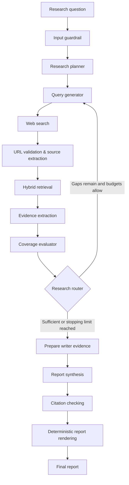

# Deep Research Agent

An evidence-grounded, multi-agent research application built with **Python, FastAPI, LangGraph, LangChain, and a lightweight SQLite job store**.

Given a question, the system develops a research plan, searches the web, retrieves relevant passages, extracts evidence, checks coverage, and produces a report with citations. If evidence is insufficient, it can perform a **bounded, gap-targeted follow-up research round** rather than repeating the entire investigation.

The web interface shows the workflow as it runs: planning, searching, extraction, retrieval, coverage checks, research retries, writing, citation checking, and report finalization.

> **Project status:** Phase 1 (end-to-end research pipeline) and the main Phase 2 features (research-quality controls, bounded loops, SQLite-backed jobs, SSE events, and live UI) have been implemented. The SQLite/event-streaming unit tests have passed. Full end-to-end validation and research-output quality tuning are still in progress. The recently proposed Groq/Gemini configuration and structured-output retry changes should be verified in your local branch before treating them as operational.

## Contents

- [Features](#features)
- [How it works](#how-it-works)
- [Architecture](#architecture)
- [Repository structure](#repository-structure)
- [Getting started](#getting-started)
- [Configuration](#configuration)
- [API](#api)
- [Live pipeline events](#live-pipeline-events)
- [Persistence and job lifecycle](#persistence-and-job-lifecycle)
- [Testing](#testing)
- [Current limitations](#current-limitations)
- [Implementation progress](#implementation-progress)

## Features

### Research pipeline

- **Question planning:** Breaks a research question into subquestions and objectives.
- **Targeted query generation:** Generates search queries for each objective; follow-up rounds focus on unresolved coverage gaps.
- **Web search and extraction:** Uses configurable search/extraction providers (currently Tavily), validates public URLs, preserves source provenance, and avoids extracting an already-known URL again.
- **Hybrid retrieval:** Chunks extracted pages, combines semantic and lexical relevance, ranks passages, and sends a bounded selection to evidence extraction instead of sending entire webpages to the LLM.
- **Evidence extraction:** Produces structured, source-linked evidence associated with research subquestions.
- **Coverage evaluation:** Assesses subquestions as `supported`, `partial`, `missing`, or `conflicting`, with evidence-strength assessments and actionable gaps.
- **Bounded follow-up research:** Enforces iteration, query, page-extraction, time, and no-progress safeguards; stops when coverage is sufficient or additional research is no longer justified.
- **Report generation:** Synthesizes an executive summary, findings, limitations, and sources from accepted evidence.
- **Citation verification:** Checks grounding and citations before deterministic Markdown rendering.

### Application and UI

- **FastAPI API** with both a synchronous endpoint and persistent asynchronous research jobs.
- **SQLite persistence** for job metadata, final results, and ordered workflow events.
- **Server-Sent Events (SSE)** to display execution progress in real time.
- **Per-round workflow timeline** showing stage completion, coverage results, and why another research round was triggered.
- **Browser refresh recovery:** Reloads the most recent job or a shared job link and replays saved events.
- **Structured logging** with job/session identifiers and node metadata.
- **Pluggable LLM architecture:** Research nodes call a shared LLM service rather than depending directly on a provider SDK.

## How it works



### Research rounds and stopping decisions

The coverage evaluator assesses whether the gathered evidence answers each planned subquestion. If it detects missing information, it returns **specific gaps** and may suggest follow-up queries. The router decides whether another round is allowed, based on deterministic budgets rather than an unrestricted LLM decision.

Research can stop because of:

- Sufficient evidence coverage.
- Maximum research iterations, queries, extraction attempts, or elapsed time.
- No improvement in newly referenced evidence across follow-up rounds.
- No actionable research gaps remaining.

When research must stop before achieving full coverage, the writing stage should present supported findings and disclose unresolved limitations rather than invent missing information.

## Architecture

```text
Browser (HTML / CSS / JavaScript)
    |
    | Create job, fetch status, subscribe to SSE
    v
FastAPI routes
    |
    v
ResearchService ------------------------------+
    |                                          |
    | One LangGraph execution per job          | Job status + report
    v                                          v
Compiled LangGraph                     SQLite ResearchJobStore
    |                                          ^
    | Node execution events                    |
    v                                          |
PipelineRecorder -----------------------------+
    |
    +--> Saved event history --> SSE --> Live workflow UI
```

**Separation of responsibilities:**

| Component | Responsibility |
|---|---|
| `src/graph/` | Workflow state, graph construction, and routing decisions |
| `src/agents/research/` | Planning, query generation, searching, extraction, retrieval, and coverage evaluation |
| `src/agents/writer/` | Evidence preparation, report writing, and citation checking |
| `src/retrieval/` | Chunking, embeddings, hybrid ranking, and LLM-facing context selection |
| `src/tools/` | Search and webpage extraction provider interfaces |
| `src/guardrails/` | Question and URL safety/validation checks |
| `src/llm/` | Shared structured-output interface and model creation |
| `src/rendering/` | Validated report-to-Markdown rendering |
| `src/services/research_service.py` | Job creation, graph execution, and result conversion |
| `src/services/research_pipeline_stream.py` | LangGraph event capture and SSE serialization |
| `src/persistence/research_job_store.py` | Persistent job records and replayable events |
| `src/routes/` | HTTP API and page endpoints |
| `src/static/` | Research workspace and final-report UI |

### Repository structure

Key files and folders (the actual repository contains additional models, prompts, and helpers):

```text
.
├── src/
│   ├── agents/
│   │   ├── research/
│   │   └── writer/
│   ├── config/
│   ├── graph/
│   │   ├── graph_builder.py
│   │   ├── graph_routing.py
│   │   └── graph_state.py
│   ├── guardrails/
│   ├── llm/
│   │   ├── factory.py
│   │   ├── roles.py
│   │   └── service.py
│   ├── models/
│   │   ├── pipeline_event.py
│   │   ├── report_model.py
│   │   └── ...
│   ├── persistence/
│   │   ├── __init__.py
│   │   └── research_job_store.py
│   ├── prompts/
│   ├── rendering/
│   ├── retrieval/
│   ├── routes/
│   │   └── research_route.py
│   ├── services/
│   │   ├── research_pipeline_stream.py
│   │   └── research_service.py
│   ├── static/
│   │   ├── index.html
│   │   ├── css/styles.css
│   │   └── js/app.js
│   ├── tools/
│   │   ├── extraction/
│   │   └── search/
│   └── server.py
├── data/                         # SQLite database (created automatically)
├── tests/
├── requirements.txt
└── .env                          # Local configuration; never commit secrets
```

## Getting started

### Prerequisites

- Python environment compatible with the versions pinned in `requirements.txt`.
- A Tavily API key for the current web-search and extraction implementation.
- An API key for the chosen LLM provider (Groq by default in the original configuration).
- Internet access for web research and any first-run local model/tokenizer downloads.

### 1. Install dependencies

From the repository root:

```bash
python -m venv .venv
source .venv/bin/activate       # Windows: .venv\Scripts\activate
python -m pip install -r requirements.txt
```

The Phase 2 job store needs `aiosqlite`. If it is not yet listed in your requirements, add:

```text
aiosqlite>=0.20,<1
```

The provider-switching version of the LLM factory additionally requires the corresponding LangChain integrations, such as `langchain-groq` and/or `langchain-google-genai`.

### 2. Configure `.env`

The following example assumes the current Groq research setup:

```dotenv
TAVILY_API_KEY=your_tavily_api_key
GROQ_API_KEY=your_groq_api_key

PLANNER_MODEL=openai/gpt-oss-120b
QUERY_GENERATOR_MODEL=openai/gpt-oss-120b
EVIDENCE_MODEL=openai/gpt-oss-120b
COVERAGE_MODEL=openai/gpt-oss-120b
WRITER_MODEL=openai/gpt-oss-120b
CITATION_MODEL=openai/gpt-oss-120b

SEARCH_PROVIDER=tavily
WEB_EXTRACTOR_PROVIDER=tavily

RETRIEVAL_MAX_CONTEXT_TOKENS=3000
MAX_WRITER_EVIDENCE_ITEMS=40
MAX_WRITER_EVIDENCE_CHARS=30000
MAX_ITERATIONS=3
MAX_TOTAL_QUERIES_PER_JOB=10

LLM_TIMEOUT_SECONDS=60
LLM_MAX_RETRIES=2

# Optional: override the default SQLite file location.
# RESEARCH_DB_PATH=data/research.sqlite3
```

The Pydantic settings classes read these values from `.env`. Do not commit real API keys; provide a sanitized `.env.example` in the repository if you want to share configuration defaults.

### 3. Run the application

```bash
uvicorn src.server:app --reload
```

Open **http://127.0.0.1:8000/** and submit a research question.

For production-like testing, use a **single server process**. The current background-job registry is in memory and is not designed to coordinate execution across multiple Uvicorn workers.

## Configuration

### Retrieval and evidence context

| Environment variable | Default | Purpose |
|---|---:|---|
| `RETRIEVAL_EMBEDDING_MODEL` | `BAAI/bge-small-en-v1.5` | Local embedding model |
| `RETRIEVAL_CHUNK_SIZE` | `400` | Retrieval chunk sizing |
| `RETRIEVAL_CANDIDATE_K` | `10` | Candidates considered during retrieval |
| `RETRIEVAL_TOP_K` | `5` | Top retrieved passages |
| `RETRIEVAL_MAX_CONTEXT_TOKENS` | `3000` | Retrieval-context token budget |
| `RETRIEVAL_MAX_CHUNKS_PER_DOCUMENT` | `3` | Diversity cap per source document |
| `RETRIEVAL_CONTEXT_TOKENIZER_MODEL` | `openai/gpt-oss-120b` | Local tokenizer used for context accounting |
| `MAX_WRITER_EVIDENCE_ITEMS` | `40` | Max evidence items prepared for writing |
| `MAX_WRITER_EVIDENCE_CHARS` | `30000` | Writer evidence-text cap, in **characters** |

**Token accounting caveat:** `RETRIEVAL_MAX_CONTEXT_TOKENS` limits the selected retrieval context, **not the complete LLM request**. System prompts, schemas, instructions, and generated responses add tokens. The writer limit is currently character-based. A global per-call output-token cap and per-job token quota have **not** been implemented.

When switching from Groq to Gemini, the local `RETRIEVAL_CONTEXT_TOKENIZER_MODEL` does not automatically change. Its estimates may differ from the selected provider's actual token counts.

### Research limits

| Environment variable | Default | Purpose |
|---|---:|---|
| `MAX_SUBQUESTIONS` | `4` | Planning scope |
| `MAX_QUERIES_PER_SUBQUESTION` | `2` | Initial/follow-up query generation limit per subquestion call |
| `MAX_TOTAL_QUERIES_PER_JOB` | `10` | Total query limit |
| `MAX_SEARCH_RESULTS_PER_QUERY` | `5` | Search result cap |
| `MAX_EVIDENCE_ITEMS` | `100` | Maximum accumulated evidence items |
| `MIN_EVIDENCE_RELEVANCE` | `0.60` | Minimum relevance threshold |
| `MAX_ITERATIONS` | `3` | Research round cap |

The Phase 2 `ResearchBudget` / `ResearchControlState` also provides controls for extraction attempts, elapsed research time, and consecutive no-gain rounds. The router uses conservative limits, while search and extraction nodes enforce applicable budgets **before** provider calls. Some Phase 2 budget defaults still live in the research-quality models; they are not all configurable through `.env` yet.

### LLM providers (latest integration step)

The original factory explicitly used Groq. The **recently proposed** factory update makes the provider configurable without changing research nodes:

```dotenv
LLM_PROVIDER=groq
PLANNER_MODEL=openai/gpt-oss-120b
WRITER_MODEL=openai/gpt-oss-120b
```

For Gemini, after applying the provider-selectable factory, settings, and LLM-service changes:

```dotenv
LLM_PROVIDER=google_genai
GOOGLE_API_KEY=your_google_api_key

# Use model IDs available to your Google API account.
PLANNER_MODEL=YOUR_GEMINI_MODEL_ID
QUERY_GENERATOR_MODEL=YOUR_GEMINI_MODEL_ID
EVIDENCE_MODEL=YOUR_GEMINI_MODEL_ID
COVERAGE_MODEL=YOUR_GEMINI_MODEL_ID
WRITER_MODEL=YOUR_GEMINI_MODEL_ID
CITATION_MODEL=YOUR_GEMINI_MODEL_ID

LLM_STRUCTURED_OUTPUT_METHOD=json_schema
LLM_STRUCTURED_OUTPUT_ATTEMPTS=2
```

With the updated factory, individual role settings may also use a `groq:` or `google_genai:` prefix to override the default provider. Verify the configured model's structured-output capabilities before running a full research job. **The Gemini provider switch and malformed-JSON retry improvements have been proposed in code but have not been confirmed by the passing SQLite/SSE tests.**

### Other important settings

| Variable | Purpose |
|---|---|
| `SEARCH_PROVIDER` | Search backend (currently `tavily`) |
| `WEB_EXTRACTOR_PROVIDER` | Page extraction backend (currently `tavily`) |
| `SEARCH_TIMEOUT_SECONDS` | Search timeout |
| `EXTRACTION_TIMEOUT_SECONDS` | Extraction timeout |
| `MIN_PROVIDER_SCORE` | Provider search-score threshold |
| `APP_ENV` | `development`, `test`, or `production` |
| `GRAPH_RECURSION_LIMIT` | LangGraph recursion safety limit |
| `LOG_LEVEL` | Application logging level |
| `RESEARCH_DB_PATH` | SQLite file path; default `data/research.sqlite3` |

## API

The backend exposes a legacy synchronous endpoint and a job-based workflow for the interactive UI.

| Method | Endpoint | Description |
|---|---|---|
| `POST` | `/api/research` | Run a complete research workflow and return the result in one response |
| `POST` | `/api/research/jobs` | Create a persistent job; returns `202 Accepted` |
| `GET` | `/api/research/jobs/status/{job_id}` | Get job status and the final result, when available |
| `GET` | `/api/research/jobs/{job_id}/events` | Replay and stream SSE events |

### Create an asynchronous research job

```bash
curl -X POST http://127.0.0.1:8000/api/research/jobs \
  -H 'Content-Type: application/json' \
  -d '{
    "question": "How do AI coding assistants affect developer productivity?",
    "sources": ["web"]
  }'
```

Example response (`202 Accepted`):

```json
{
  "job_id": "JOB-example",
  "research_session_id": "RS-example",
  "status": "queued"
}
```

### Check status or retrieve the report

```bash
curl http://127.0.0.1:8000/api/research/jobs/status/JOB-example
```

Job status is `queued`, `running`, `completed`, or `failed`. The `result` field contains the application's `ResearchExecutionResult` after the job reaches a terminal state. Successful results include report summary, findings, limitations, sources, and generated Markdown.

### Watch pipeline events

```bash
curl -N http://127.0.0.1:8000/api/research/jobs/JOB-example/events
```

To replay only events after sequence 20:

```bash
curl -N 'http://127.0.0.1:8000/api/research/jobs/JOB-example/events?after=20'
```

The endpoint also accepts the SSE `Last-Event-ID` header for reconnects.

## Live pipeline events

The application observes **one LangGraph execution per asynchronous job** using LangGraph's event stream. It persists a small subset of information to SQLite and sends it to the browser as SSE.

Representative event types:

| Event | Meaning |
|---|---|
| `workflow_started` | Job execution began |
| `stage_started` | A workflow node started |
| `stage_completed` | A workflow node completed |
| `stage_failed` | A node emitted an execution failure |
| `research_retry` | Router scheduled another research iteration |
| `research_stopped` | Research ended and the writer may begin |
| `workflow_completed` | The final report is available via the status endpoint |
| `workflow_failed` | The job ended unsuccessfully |

An example SSE message:

```text
id: 12
event: research_retry
data: {"job_id":"JOB-example","sequence":12,"event_type":"research_retry","stage":"research_routing","status":"retrying","iteration":1,"details":{"next_iteration":2,"gap_count":2,"reason":"Unresolved gaps remain."},"timestamp":"2026-10-10T00:00:00Z"}
```

Progress events **do not include full LLM prompts, webpage contents, evidence bodies, or final reports**. The UI uses event metadata (such as stage, round number, coverage status, gap count, and router action). It fetches the final report separately from the status endpoint.

The frontend supports refreshing the page during execution, loading a job from a `?job=...` link, reconnecting to events, and reconstructing previous research rounds.

## Persistence and job lifecycle

SQLite stores two primary tables:

- `research_jobs`: job ID, session ID, question, allowed sources, lifecycle status, final result, timestamps, and error information.
- `research_events`: ordered, per-job pipeline events with `(job_id, sequence)` as the primary key.

The database is initialized at application startup and uses WAL mode. By default, it is stored at `data/research.sqlite3`.

Asynchronous jobs run as application-owned asyncio tasks and **continue if an SSE client disconnects**. The current service defaults to **two concurrently executing jobs** and **20 in-process outstanding jobs** (including running and queued jobs). These values are constructor defaults, not `.env` settings yet.

The **legacy synchronous** `POST /api/research` endpoint still works but does not use this persistent-job flow.

**Important distinction:** Persisted *jobs and events* do not mean LangGraph *execution checkpointing*. If the process restarts before a job finishes, the job is marked `failed`; it is **not resumed from the last completed graph node**. Full recovery would require a checkpointer and idempotent handling of external calls.

To avoid committing personal research contents and API credentials, add these patterns to `.gitignore`:

```gitignore
.env
.venv/
data/*.sqlite3
data/*.sqlite3-wal
data/*.sqlite3-shm
```

## Testing

Run unit tests from the repository root:

```bash
python -m pytest tests/test_research_job_store.py -v
python -m pytest tests/test_research_pipeline_stream.py -v
```

Both of these test files were reported **passing locally** after fixing an obsolete import in `src/graph/__init__.py`.

They cover SQLite job lifecycle, ordered event replay, restart handling, SSE serialization, research retry events, and capturing a graph's final result without a second execution. The fake-graph test does **not** call Groq, Gemini, Tavily, or the real research graph.

For broader checks:

```bash
python -m pytest tests/ -v
```

If you added the latest LLM-service tests, you can also run:

```bash
python -m pytest tests/test_llm_service.py -v
```

The redesigned frontend has been smoke-tested with **mocked API responses** in desktop and mobile browsers. A complete live integration test against the FastAPI server, database, external search tools, and LLM providers is still needed.

Suggested manual end-to-end checks:

1. Start a job and confirm `queued` → `running` → `completed` or `failed`.
2. Confirm node events appear in the UI and repeat research stages when coverage triggers another round.
3. Refresh the page during research and confirm event replay reconstructs the timeline.
4. Confirm the status API returns the same final report shown in the browser.
5. Verify failed writer or provider calls end in a visible failed job, not a permanently running state.

## Current limitations

- **Web sources only in the active pipeline.** `DOCUMENTS` and `MCP` are represented in the source models but private-document retrieval and connected-app research are not yet implemented.
- **No authentication or per-user authorization.** Anyone who can access the API and knows a job ID may be able to read stored questions, reports, and event history. Do not expose this deployment publicly without access controls.
- **SQLite targets a single API process.** In-memory task ownership is not coordinated across multiple workers or machines.
- **No LangGraph checkpoint resume.** Jobs interrupted by a server restart are marked failed.
- **No global LLM token budget.** Retrieval context is capped, but complete request/output token limits, total job quotas, and provider-level TPM management are not yet implemented.
- **Provider reliability still needs tuning.** Structured-output failures can occur during long report synthesis. The Groq/Gemini schema-mode and bounded-retry changes require live provider verification.
- **Quality is an ongoing focus.** Better relevance scoring, source-quality assessment, gap resolution, and citation grounding remain areas for iteration.
- **UI coverage details are summarized.** Current SSE metadata includes coverage status and counts, not full assessment text or evidence documents.
- **Not production-hardened yet.** Persistent event retention, migrations, request authentication, queue durability, rate limiting, multi-instance scheduling, and operational monitoring need further work.

## Implementation progress

| Stage | Scope | Status |
|---|---|---|
| **Phase 1** | Research planning, search, webpage extraction, hybrid retrieval, evidence extraction, writing, citation checks, report rendering, initial UI | Implemented; quality tuning ongoing |
| **Phase 2.1–2.3** | Evidence-quality contracts, coverage evaluator, gap-targeted research, bounded loops | Implemented; broader integration tests pending |
| **Phase 2.4** | Job/event SQLite persistence, single-run LangGraph event recording, SSE/status endpoints | Implemented; persistence/streaming unit tests passed |
| **Phase 2.5** | Redesigned live pipeline UI, per-round history, reconnect/replay, report display | Implemented; mocked browser checks passed |
| **LLM reliability extension** | Configurable Groq/Gemini providers, JSON Schema output, selective retries | Proposed code supplied; live verification pending |
| **Future work** | Private document support, richer observability/token accounting, checkpoint recovery, security, full end-to-end testing | Not implemented |

---

**Design principle:** Spend LLM tokens on relevant evidence and synthesis—not entire webpages or repeated broad searches—and make every decision to continue, stop, or retry research explainable to the user.
